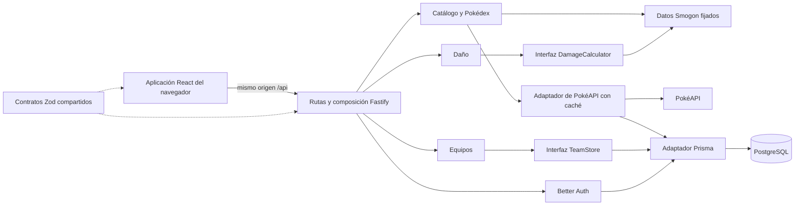

 

# Arquitectura del sistema

**Alcance:** versión aprobada de la novena generación de Escarlata/Púrpura en inglés y español de España. **Estado (22-10-2026):** este documento es un mapa vivo de la implementación local y del diseño de despliegue. El propietario informa de que staging y producción se han desplegado correctamente y de que la página de producción está disponible en `https://jcrserver.duckdns.org`. También se completaron una copia de seguridad de staging y una prueba de restauración en una base de datos desechable. La parte 6 añadió navegación basada en rutas y SEO básico; el [último registro de workflow](../tfm/ai-methodology/workflows/007-post-rollout-product-evolution.es.md) recoge las comprobaciones y limitaciones. Siguen pendientes la entrada al host y la revisión visual en navegador. La [guía de la web](../website-guide.es.md) ofrece el mapa de funciones y archivos; la [auditoría de código fechada](../code-audit-2026-10-03.es.md) conserva la evidencia histórica. Los [requisitos](../requirements/requirements.es.md) distinguen el alcance aprobado del progreso de implementación y verificación.

Este documento describe responsabilidades e interacciones. Las decisiones aprobadas y sus compensaciones se registran en los ADR indicados más abajo.

## Workspace y ejecución

| Ubicación | Responsabilidad |
| --- | --- |
| [`apps/web`](../../apps/web/) | Frontend React/Vite, rutas React Router, idiomas inglés y español de España, vistas, borradores de visitantes y llamadas API del mismo origen. |
| [`apps/api`](../../apps/api/) | Un proceso Fastify con rutas HTTP y módulos `catalog`, `damage`, `teams` y `auth`. |
| [`packages/contracts`](../../packages/contracts/) | Esquemas Zod de solicitudes y datos, seguros para el navegador y compartidos por frontend/API. |
| [`infra`](../../infra/) | Proyectos Compose separados, configuración de Caddy compartido y scripts de despliegue, copia de seguridad y restauración. |
| [`docs`](../) | Requisitos, mapa del sistema, historial de decisiones y guías operativas. |

En local, Vite se ejecuta en `127.0.0.1:5173` y redirige `/api` a Fastify en `127.0.0.1:4000`. La imagen de despliegue contiene el frontend compilado y la API; Fastify sirve los archivos estáticos, `/api`, `robots.txt` y `sitemap.xml` desde su puerto interno. Por eso, el navegador llama a `/api` en su propio origen. Staging y producción usan el mismo digest de imagen, con configuración de ejecución y bases de datos PostgreSQL separadas; la imagen no incluye secretos de base de datos ni de autenticación.

Las rutas del navegador son `/`, `/type-chart`, `/pokedex`, `/pokedex/:slug`, `/team-builder`, `/damage` y `/account`. Los slugs aptos de la Pokédex proceden del manifiesto de identidades incluido en el repositorio. `PUBLIC_BASE_URL`, expuesta mediante `/api/site-config`, determina el origen canónico. El fallback de Fastify sirve la aplicación para rutas conocidas y entradas de especies, y devuelve HTTP 404 para slugs de Pokédex desconocidos. Los títulos y descripciones de página se renderizan en el cliente y se localizan; quedan aplazadas la renderización en servidor y las URL separadas por idioma.

## Interacciones de la aplicación

El diagrama muestra dependencias de la aplicación, no servicios desplegables por separado. [`app.ts`](../../apps/api/src/app.ts) registra en un mismo sitio las rutas, los plugins transversales de Fastify y los módulos concretos. Es tanto el punto de composición como el archivo de rutas HTTP. La API lee de la configuración de ejecución `NODE_ENV`, el entorno de despliegue, la URL base, los orígenes de confianza, la URL de base de datos y el CIDR de entrada.

| Módulo | Responsabilidad y límite actual |
| --- | --- |
| `catalog` | Proporciona especies, movimientos, habilidades, objetos, naturalezas y efectividad de tipos de la novena generación a partir de `@smogon/calc` fijado. Las instantáneas generadas e incluidas en el repositorio, procedentes de PokéAPI, aportan etiquetas oficiales en inglés/español de España, números nacionales, slugs estables y repertorios de Escarlata/Púrpura. El [adaptador de PokéAPI](../../apps/api/src/modules/catalog/pokeapi-adapter.ts) solicita detalles descriptivos de Pokémon, los guarda en caché en PostgreSQL y devuelve un estado no disponible cuando hace falta. Los datos de combate son independientes de esas solicitudes. |
| `damage` | Valida nombres conocidos del catálogo y pasa el conjunto seleccionado, el movimiento y el campo al [adaptador de Smogon](../../apps/api/src/modules/damage/smogon-adapter.ts). La interfaz `DamageCalculator` permite sustituir la aplicación en pruebas. La respuesta incluye intervalos de daño y la probabilidad condicional de debilitar de un golpe. |
| `teams` | Expone operaciones para guardar, listar y eliminar equipos del propietario autenticado. La [interfaz TeamStore](../../apps/api/src/modules/teams/teams.ts) está implementada por un [adaptador Prisma](../../apps/api/src/modules/teams/prisma-adapter.ts); las operaciones de persistencia filtran por propietario. |
| `auth` | Usa Better Auth con usuarios, sesiones, cuentas y verificaciones guardados por Prisma. La API comprueba la sesión antes de operar sobre equipos privados. |

Los límites son prácticos y no reproducen una estructura completa de Clean Architecture. Por ejemplo, la validación de equipos llama a `damage.validateSet`, cuya implementación predeterminada conecta el adaptador de Smogon. Las lecturas sencillas del catálogo también acceden directamente a `@smogon/calc`. No debe describirse esta estructura observada como una inversión estricta de dependencias. Son posibles refactorizaciones si estas dependencias dificultan las pruebas o los cambios; este documento no implica que haya que refactorizar.

## Datos y propiedad

Los borradores de equipo y de comparación de visitantes se guardan en `localStorage` del navegador con claves versionadas y migración desde claves anteriores. Si falla el almacenamiento, el editor en memoria sigue funcionando. Cada borrador admite hasta seis conjuntos. Al abrir un equipo privado guardado, su conjunto se copia al borrador del navegador y permanece allí al cerrar sesión. Los equipos guardados son registros privados de base de datos asociados a un usuario autenticado. El [esquema Prisma](../../apps/api/prisma/schema.prisma) contiene `User`, `Session`, `Account` y `Verification` para autenticación, `Team` para conjuntos guardados y `PokedexCache` para metadatos descriptivos. Actualmente todas las tablas están en una base de datos por entorno; la propiedad de los módulos es una convención del código, no esquemas de base de datos separados.

Los datos y las mecánicas de daño proceden de `@smogon/calc` fijado. PokéAPI aporta sprites y otros campos descriptivos, etiquetas oficiales localizadas, datos de evolución y repertorios registrados de Escarlata/Púrpura mediante instantáneas generadas y equivalencias explícitas de formas. Si PokéAPI deja de estar disponible, los detalles obtenidos en vivo pueden faltar o quedar obsoletos, pero los valores de combate no se sustituyen. El selector de idioma cambia la presentación y conserva los valores canónicos en borradores y solicitudes. Estos flujos respaldan [REQ-003](../requirements/requirements.es.md#req-003), [REQ-004](../requirements/requirements.es.md#req-004), [REQ-006](../requirements/requirements.es.md#req-006), [REQ-009](../requirements/requirements.es.md#req-009) y los requisitos añadidos de idioma/Pokédex.

## Topología de entornos

Hay tres proyectos Compose: Caddy compartido, aplicación/base de datos de staging y aplicación/base de datos de producción. Caddy se conecta a una red de entrada dedicada por aplicación y tiene su propia red de entrada. Cada aplicación se conecta además solo a su red interna de base de datos. Los servicios de base de datos no están en las redes de entrada y Fastify no publica un puerto del host. Esta topología está definida en la configuración del repositorio; hay que comprobar su comportamiento en el mini PC.

| Ruta del navegador | Camino previsto a la aplicación |
| --- | --- |
| Producción pública, preferida | Navegador → registro DuckDNS corregido y HTTPS → listener público de Caddy → Fastify de producción. |
| Staging privado | Navegador autorizado de tailnet → servicio Tailscale con HTTPS Serve → listener Caddy de staging publicado en loopback del host → Fastify de staging. |
| Alternativa pública de producción | Navegador → HTTPS Funnel de Tailscale → otro listener de producción de Caddy publicado en loopback del host → Fastify de producción. |

Staging utiliza un host distinto del de producción, incluido el fallback Funnel opcional, para separar las cookies vinculadas al host. Caddy es el proxy inverso de la aplicación en todas las rutas configuradas. En el listener público, la configuración sobrescribe las cabeceras de reenvío enviadas por el navegador. Los listeners de Tailscale aceptan la dirección reenviada del cliente solo desde el par de proxy inmediato configurado y reescriben las cabeceras que envían a Fastify. Antes de la autenticación, la protección de entrada de Fastify compara el par de socket bruto con el CIDR de entrada del entorno; la confianza del proxy se limita al mismo CIDR. Better Auth utiliza la cabecera de IP depurada por Caddy y las URL base y orígenes de confianza explícitos. El límite depende de controlar la pertenencia a redes y los CIDR, no de una IP fija del contenedor Caddy. El propietario informa de que las rutas de aplicación funcionan; siguen pendientes las comprobaciones de cabeceras falsificadas, pares externos, cookies y cabeceras de seguridad desplegadas. Consulta [REQ-011](../requirements/requirements.es.md#req-011) y [REQ-012](../requirements/requirements.es.md#req-012).

## Interfaces de publicación y recuperación

Las comprobaciones de GitHub preceden a la compilación de staging. Si el workflow de staging termina correctamente, publica una imagen en GHCR, despliega su digest inmutable, ejecuta pruebas de humo por la ruta privada y registra el commit, el árbol Git y el digest. Una promoción protegida compara el árbol Git de `main` con el probado y, tras la aprobación, despliega ese mismo digest. El despliegue y la reversión recrean solo el servicio de aplicación; las migraciones deben seguir siendo compatibles con la imagen anterior. Los scripts de copia y restauración de PostgreSQL utilizan un repositorio restic cifrado en el USB del mini PC. El script de producción exige marcas de verificación de entrada pública y restauración del USB. La [guía de operaciones](../operations.es.md) contiene el procedimiento del host y las comprobaciones pendientes; [REQ-014](../requirements/requirements.es.md#req-014), [REQ-015](../requirements/requirements.es.md#req-015) y [REQ-016](../requirements/requirements.es.md#req-016) registran su progreso.

## Estado de verificación y lagunas conocidas

- El 03-10-2026 pasaron lint, comprobaciones de tipos, compilaciones de producción web/API, 24 pruebas de API, 15 pruebas web, comprobaciones estáticas de configuración y cuatro recorridos Playwright. La prueba de cuenta usó datos desechables de PostgreSQL para crear dos cuentas y comprobar el aislamiento de las operaciones de listar/eliminar. Las pruebas de inyección API cubren orígenes, errores seguros, registros, esquemas de respuesta y cabeceras de proxy; las pruebas de adaptador cubren el fallback de PokéAPI y operaciones de equipo limitadas al propietario. También se hicieron revisiones visuales de escritorio/móvil con respuestas API simuladas.
- Siguen pendientes la ejecución CI, el arranque de la imagen de producción y las comprobaciones de Caddy/Tailscale desplegados. Las respuestas de rutas propias declaran ahora esquemas y metadatos de estado/seguridad; las operaciones comodín de Better Auth siguen delegadas y no se describen de forma exhaustiva. Consulta [REQ-010](../requirements/requirements.es.md#req-010) y [REQ-017](../requirements/requirements.es.md#req-017).
- En este entorno se denegó el acceso al motor Docker, pero había un servicio PostgreSQL local disponible. La auditoría creó y eliminó una base de datos dedicada a los recorridos de cuenta en navegador. El propietario informó anteriormente del despliegue de staging/producción, la accesibilidad básica y una prueba de restauración de staging; esta auditoría local no verifica esos datos del host de forma independiente. Siguen sin comprobarse Tailscale Funnel, las cabeceras de proxy, CSP/cookies desplegadas, el envío de correo y la reversión.
- El 22-10-2026 pasaron ESLint del repositorio, comprobaciones TypeScript de web/API, compilación de contratos, compilación de producción de Vite, auditoría de textos de interfaz, 49 pruebas API y 82 pruebas web para idioma, Pokédex, movimientos y rutas directas. La prueba Playwright de rutas no pudo iniciarse porque falta el Chromium configurado. Siguen pendientes la revisión visual humana, la indexación desplegada y la indexación externa en buscadores.

## Registros de decisión

| Registro | Decisión |
| --- | --- |
| [ADR-001](../adr/ADR-001-modular-monolith.es.md) | Monolito modular y límites pragmáticos de Clean Architecture. |
| [ADR-002](../adr/ADR-002-data-authority-and-provenance.es.md) | Autoridad de los datos de combate, descriptivos y publicados. |
| [ADR-003](../adr/ADR-003-private-teams-and-identity.es.md) | Identidad y almacenamiento privado de equipos. |
| [ADR-004](../adr/ADR-004-compose-and-shared-caddy.es.md) | Topología Compose y Caddy compartido. |
| [ADR-005](../adr/ADR-005-caddy-proxy-trust.es.md) | Ruta controlada de confianza del proxy. |
| [ADR-006](../adr/ADR-006-immutable-release-and-recovery.es.md) | Promoción por digest y comprobaciones de recuperación. |

## Influencia del curso y decisiones del proyecto

Los documentos validados **Arquitectura del software → Introducción a la arquitectura de software → Monolito modular**, **Aplicando Clean Architecture con TypeScript → Estructura de carpetas de un proyecto Clean** y **Puertos y adaptadores** explican los límites modulares y la selección de dependencias. Orientan esta descripción, pero no eligen el stack, los nombres de módulos ni la topología de despliegue del proyecto. Esas son decisiones de Pokémon Tools aprobadas por el propietario. El material del curso permanece en la base privada de conocimiento y no se copia en este repositorio público.
