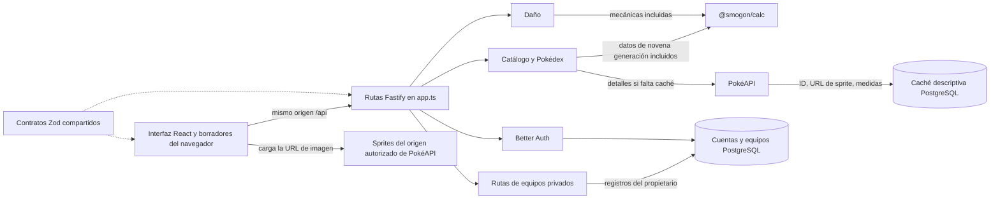

 

# Cómo funciona la web

**Revisado:** 22-10-2026. Esta guía describe la implementación actual en inglés y español de España para la novena generación, tras los cambios de localización, Pokédex, movimientos y rutas. Es un mapa del código, no una prueba de que todas las funciones hayan superado la aceptación en producción. La [auditoría de código](code-audit-2026-10-03.es.md) es histórica; el [workflow más reciente](tfm/ai-methodology/workflows/007-post-rollout-product-evolution.es.md) registra la implementación y las comprobaciones posteriores.

## Componentes de la web

La web se ejecuta como una aplicación React en el navegador y un proceso Fastify en el servidor. React Router asigna las vistas a `/`, `/type-chart`, `/pokedex`, `/pokedex/:slug`, `/team-builder`, `/damage` y `/account`. La URL identifica la entrada de la Pokédex seleccionada; se admiten enlaces directos, recargas y el historial del navegador. El estado compartido de equipos, cuenta y sesión permanece por encima del contenido de las rutas.

| Componente | Ubicación | Función |
| --- | --- | --- |
| Aplicación y punto de entrada del navegador | [`apps/web/src/main.tsx`](../apps/web/src/main.tsx) | Monta React StrictMode y BrowserRouter; coordina las rutas, el catálogo y la biblioteca compartidos, la sesión, los dos borradores y la composición del creador de equipos. Al montar, solicita el catálogo, la tabla de tipos, la sesión y la configuración pública del sitio. |
| Vistas de funciones | [`apps/web/src/features/`](../apps/web/src/features/) | Agrupa las vistas de inicio, tabla de tipos, Pokédex, editor y comparación de equipos, cálculo de daño y cuenta. El estado y los efectos propios de cada función se mantienen junto a sus componentes. |
| Cliente API y errores localizados | [`apps/web/src/lib/api.ts`](../apps/web/src/lib/api.ts) y [`apps/web/src/lib/errors.ts`](../apps/web/src/lib/errors.ts) | Añade `/api` a las solicitudes, envía cookies del mismo origen, valida respuestas con esquemas Zod compartidos y muestra los errores mediante códigos y detalles de validación traducidos. Los errores de red y de respuesta inesperada también usan los recursos de idioma. |
| Recursos y selección de idioma | [`apps/web/src/locales/en.ts`](../apps/web/src/locales/en.ts), [`apps/web/src/locales/es-ES.ts`](../apps/web/src/locales/es-ES.ts), [`apps/web/src/i18n/LocaleProvider.tsx`](../apps/web/src/i18n/LocaleProvider.tsx) y [`apps/web/src/i18n/presentation.ts`](../apps/web/src/i18n/presentation.ts) | Proporciona textos de interfaz en inglés y español de España y un idioma reactivo. La preferencia guardada tiene prioridad sobre el idioma del navegador; cualquier idioma español selecciona `es-ES`; los idiomas no compatibles pasan al inglés. El control circular con bandera cambia el idioma sin desmontar el estado de la aplicación. |
| Etiquetas localizadas y entrada del catálogo | [`apps/web/src/lib/catalog-labels.ts`](../apps/web/src/lib/catalog-labels.ts), [`apps/web/src/components/catalog-input.tsx`](../apps/web/src/components/catalog-input.tsx) y los recursos generados de la API | Muestra nombres oficiales en el idioma activo y conserva los valores canónicos en inglés en los borradores y las solicitudes. Una opción reconocida se resuelve al nombre canónico; el texto incompleto no se modifica. Las listas compartidas evitan copiar el catálogo entero a cada campo de equipo. |
| Almacenamiento de borradores | [`apps/web/src/lib/team-drafts.ts`](../apps/web/src/lib/team-drafts.ts) | Lee y guarda los dos borradores con claves versionadas de almacenamiento local, importa las claves antiguas si existen, tolera que el almacenamiento no esté disponible y conserva ediciones incompletas. |
| Reglas y contratos compartidos | [`packages/contracts/src/index.ts`](../packages/contracts/src/index.ts) | Define el aspecto de un equipo, un Pokémon, una solicitud de daño, las respuestas de API y los borradores en edición. La validación al enviar es más estricta que la recuperación de borradores. |
| Composición y rutas de API | [`apps/api/src/app.ts`](../apps/api/src/app.ts) | Combina los plugins de Fastify y registra las rutas de catálogo, tipos, detalles/evolución/movimientos de Pokédex, daño, equipos, cuenta, salud, configuración del sitio, sitemap, robots y diagnóstico. El fallback estático sirve la aplicación React para rutas válidas y devuelve HTTP 404 para slugs de Pokédex desconocidos. [`apps/api/src/main.ts`](../apps/api/src/main.ts) inicia el servidor. |
| Base de datos | [`apps/api/src/db.ts`](../apps/api/src/db.ts) y [`apps/api/prisma/schema.prisma`](../apps/api/prisma/schema.prisma) | Conecta Prisma con PostgreSQL. Las cuentas y los equipos guardados se almacenan allí; `PokedexCache` guarda campos descriptivos seleccionados de PokéAPI. |
| Servicio local de la web | [`apps/web/vite.config.ts`](../apps/web/vite.config.ts), [`apps/web/src/style.css`](../apps/web/src/style.css), [`apps/web/index.html`](../apps/web/index.html) y [`apps/api/src/main.ts`](../apps/api/src/main.ts) | En desarrollo, Vite sirve la interfaz y redirige `/api` a Fastify. En el despliegue, Fastify sirve la web compilada y la API desde la misma imagen. |

El flujo entre el navegador y el servidor es el siguiente:

## Recursos de traducción y valores canónicos

Los recursos tipados en inglés y español de España contienen textos de interfaz, marcadores de posición, avisos, etiquetas de accesibilidad, mensajes de validación y errores. El proveedor de idioma resuelve primero una preferencia guardada, después los idiomas admitidos por el navegador y, por último, el inglés; cualquier variante del español selecciona `es-ES`. Los fallos de almacenamiento no impiden usar la web. La aplicación actualiza el idioma del documento, el título y la descripción localizados y los metadatos SEO al cambiar de ruta o idioma. El selector conserva el estado montado de la aplicación.

Los datos de combate mantienen sus nombres canónicos en inglés. El catálogo local generado incluye nombres oficiales en inglés y español de España para especies/formas, movimientos, habilidades, objetos, naturalezas y tipos, a partir de datos de PokéAPI fijados (idioma 7). La instantánea está versionada en el repositorio y puede reproducirse; la compilación y el arranque no descargan estos datos. Traducir lo que se muestra no cambia los datos de combate de Smogon, los identificadores de los borradores, los registros de la base de datos ni los valores enviados a la API.

`CatalogInput` muestra sugerencias traducidas, pero guarda el nombre canónico cuando el usuario elige o escribe una sugerencia reconocida. Los nombres canónicos en inglés siguen siendo válidos. Si dos sugerencias traducidas colisionan entre sí o con un nombre canónico, `catalogOptions()` añade el nombre canónico entre paréntesis, por ejemplo, `Shared (Thunderbolt)` y `Shared (Protect)`, para distinguir las opciones. El texto no reconocido o incompleto se conserva mientras se edita; la validación habitual de guardado y cálculo sigue rechazando nombres no válidos. Los selectores de naturaleza y tipo Teracristal también muestran etiquetas traducidas y conservan los valores canónicos. La búsqueda de la Pokédex admite nombres canónicos y del idioma activo, y envía a la API la especie canónica seleccionada.

Los [recursos de error del servidor](../apps/api/src/resources/errors.ts) conservan mensajes de compatibilidad en inglés. Los errores de la aplicación también llevan códigos estables y detalles opcionales de campo o regla de los contratos compartidos. `lib/errors.ts` convierte esos datos, los errores locales de Zod y los códigos reconocidos de Better Auth en mensajes del idioma activo; no muestra texto arbitrario del servidor o de autenticación. La API no negocia una respuesta por idioma.

Las respuestas de daño incluyen enfrentamiento, modificadores y datos de daño estructurados. La interfaz presenta esos detalles en el idioma activo y omite la narración en inglés generada por la calculadora. Los nombres de equipos, motes y notas introducidos por el usuario se conservan tal como se escribieron.

## Qué muestra cada vista y de dónde proceden los datos

| Vista | Qué ve el usuario | Solicitud y lógica del servidor | Fuente y almacenamiento |
| --- | --- | --- | --- |
| Inicio | Texto introductorio y enlaces al creador de equipos, la calculadora, la tabla de tipos y la Pokédex. | [`features/overview/Overview.tsx`](../apps/web/src/features/overview/Overview.tsx); ruta `/`. Al iniciar, `main.tsx` carga el catálogo, la tabla de tipos, la sesión y la configuración del sitio. | Los textos proceden del idioma activo; no se usa un equipo de ejemplo ni una base de datos precargada. |
| Tabla de tipos | Permite elegir uno o dos tipos defensivos o usar el buscador de Pokémon. Los tipos atacantes se agrupan por multiplicador; se muestra el sprite si está disponible. | Interfaz y grupos calculados en [`features/type-chart/TypeChart.tsx`](../apps/web/src/features/type-chart/TypeChart.tsx). `GET /api/type-chart` y `GET /api/catalog` proporcionan la tabla de efectividad de la novena generación y los tipos canónicos. Un Pokémon reconocido también puede usar `GET /api/pokedex/:species` para cargar el sprite. | Los enfrentamientos proceden de los datos fijados de `@smogon/calc`. Los tipos de las especies proceden del mismo catálogo de combate. El sprite opcional utiliza la caché y el origen de imágenes de PokéAPI; el cálculo sigue disponible aunque falten detalles o imágenes. |
| Pokédex | Explora y busca especies/formas aptas ordenadas por número de la Pokédex Nacional; las formas base preceden a las alternativas. La búsqueda cubre todo el catálogo y el idioma activo. La lista muestra el número nacional; presenta 60 resultados y carga más al llegar al final o mediante un botón. Cada entrada tiene una ruta `/pokedex/:slug`. | Pantalla ligada a la ruta y solicitudes cancelables en [`features/pokedex/Pokedex.tsx`](../apps/web/src/features/pokedex/Pokedex.tsx), [`features/pokedex/PokemonMoves.tsx`](../apps/web/src/features/pokedex/PokemonMoves.tsx) y [`lib/pokedex-routes.ts`](../apps/web/src/lib/pokedex-routes.ts). `GET /api/catalog` proporciona nombres, orden y estadísticas. `GET /api/pokedex/:species` devuelve detalles; las solicitudes independientes de evolución y movimientos cargan la familia y los datos de aprendizaje. | Las estadísticas de combate proceden de `@smogon/calc`. PokéAPI y su caché aportan detalles, imágenes y evolución. Los movimientos son los datos registrados del juego base Escarlata/Púrpura; las entradas no disponibles se indican expresamente. El panel agrupa Nivel, MT, Huevo y, cuando corresponde, Otros; tipo y categoría se muestran con iconos y nombres accesibles. No se hacen afirmaciones sobre progenitores de movimientos Huevo. |
| Creador de equipos | Dos borradores independientes de hasta seis Pokémon. Cada set incluye especie, mote, objeto, habilidad, naturaleza, nivel, teratipo, estado, cuatro movimientos, EV, IV y modificadores. Al iniciar sesión se pueden cargar y guardar ambos borradores, actualizar un equipo cargado o guardar una copia. | Coordinación de equipo y borrador en [`features/teams/TeamEditor.tsx`](../apps/web/src/features/teams/TeamEditor.tsx); controles de cada Pokémon en [`features/teams/PokemonSetEditor.tsx`](../apps/web/src/features/teams/PokemonSetEditor.tsx). `GET`, `POST`, `PUT` y `DELETE /api/me/teams` listan, crean, actualizan y eliminan registros privados asociados al propietario. Antes de guardar se validan los contratos y los nombres del catálogo. | Ambos borradores y sus asociaciones opcionales con equipos guardados se conservan en el almacenamiento local. Una migración versionada importa `pokemon-guest-team` y `pokemon-comparison-team`. Los registros se guardan en PostgreSQL a través de [`modules/teams/teams.ts`](../apps/api/src/modules/teams/teams.ts) y [`modules/teams/prisma-adapter.ts`](../apps/api/src/modules/teams/prisma-adapter.ts). Si falla la carga de la biblioteca, la sesión permanece iniciada y se puede reintentar. |
| Comparación de equipos | Enfrentamientos por efectividad de tipos, controles de dirección, diagnósticos de tipos, indicadores de Velocidad y tabla de Velocidad. Cada enfrentamiento con movimiento se puede enviar a Daño junto con ambos sets completos. | Interfaz y cálculo en el navegador en [`features/teams/Compare.tsx`](../apps/web/src/features/teams/Compare.tsx). Prepara las celdas a partir de los borradores y del catálogo incluido; no usa una ruta de API independiente. | La efectividad de tipos se muestra antes de habilidades, objetos, Teracristalización, efectos de campo, éxito del movimiento, daño o probabilidad de K.O. La Velocidad compara nivel, EV/IV de Velocidad y naturaleza; excluye objetos, habilidades, estado, modificadores y efectos de campo. |
| Daño | Atacante, defensor, movimiento, Combates Individuales/Dobles, clima, terreno, pantallas, efectos de campo, intervalo de daño en PS/porcentaje, probabilidad condicional de debilitamiento en un golpe y detalles estructurados en el idioma activo. | Estado, validación y protección frente a respuestas obsoletas en [`features/damage/Damage.tsx`](../apps/web/src/features/damage/Damage.tsx). Controles en [`features/damage/DamageForm.tsx`](../apps/web/src/features/damage/DamageForm.tsx). Resultados en [`features/damage/DamageResult.tsx`](../apps/web/src/features/damage/DamageResult.tsx). `POST /api/damage` llama a [`modules/damage/smogon-adapter.ts`](../apps/api/src/modules/damage/smogon-adapter.ts), que crea las entradas de la novena generación y ejecuta `@smogon/calc`. | Datos y mecánicas de la calculadora fijados; no se usa la base de datos ni se solicitan datos de combate remotos. La probabilidad de debilitamiento presupone que el movimiento acierta y no incluye la precisión. Al editar un equipo, se oculta el resultado anterior hasta volver a calcular. |
| Cuenta | Inicio de sesión con nombre de usuario o correo, registro con nombre de usuario independiente, elección de nombre de usuario para cuentas antiguas, usuario conectado y cierre de sesión. Una tabla semántica lista los equipos guardados y sus Pokémon, con una acción para eliminarlos. | Estado y autenticación en [`features/account/Account.tsx`](../apps/web/src/features/account/Account.tsx). Better Auth recibe `GET/POST /api/auth/*`; el inicio de sesión con nombre de usuario usa su plugin correspondiente. Las rutas de equipo requieren sesión y filtran por propietario. | Los nombres de usuario se normalizan a minúsculas y son únicos. La columna anulable permite que las cuentas existentes elijan uno sin cambiar el nombre visible ni el correo. Better Auth y Prisma guardan usuarios, sesiones, cuentas y verificaciones en PostgreSQL. SMTP es opcional; al configurarlo se habilitan los correos de verificación y restablecimiento. |

## Qué no hace la web

- No incluye generaciones anteriores ni un simulador de combates entre jugadores. Inglés y español comparten las mismas rutas; no hay espacios de URL separados por idioma.
- Los metadatos SEO de la Pokédex se renderizan en el navegador; no hay renderización en servidor ni garantía de indexación en buscadores.
- Los movimientos de Escarlata/Púrpura describen la instantánea del juego base y excluyen La máscara turquesa y El disco índigo. No se muestran posibles progenitores de movimientos Huevo porque la fuente disponible no permite afirmarlos con fiabilidad.
- Que una especie, un movimiento, un objeto o una habilidad figuren en el catálogo no demuestra que un equipo sea legal o se haya usado en un torneo.
- El límite de equipo es seis, pero se pueden guardar borradores incompletos y el esquema actual permite guardar un equipo vacío. Esta guía no establece una política nueva sobre el tamaño de los equipos.
- Un equipo privado abierto desde la biblioteca pasa al borrador del Equipo A. El borrador permanece en el dispositivo tras cerrar sesión, porque usa el almacenamiento previsto para visitantes. Al cerrar sesión se ocultan y descartan de inmediato las filas de la biblioteca privada en memoria, pero no se borra el borrador local.
- Los equipos publicados por terceros se seleccionan y transcriben de sus publicaciones enlazadas; no son exportaciones completas de todos los campos posibles del simulador.
- Los bytes de los sprites de la Pokédex siguen cargándose desde un servicio externo. La altura y el peso llegan desde el servidor, pero no se muestran en la vista actual.
- Better Auth gestiona sus propias rutas comodín de cuenta. Esas operaciones no tienen las mismas descripciones OpenAPI individualizadas que las rutas de funciones de la aplicación.

## Dónde cambiar algo

| Si quieres cambiar… | Empieza aquí |
| --- | --- |
| Diseño de vistas, rutas, sesión o interacciones de la biblioteca privada | [`apps/web/src/main.tsx`](../apps/web/src/main.tsx), [`apps/web/src/lib/pokedex-routes.ts`](../apps/web/src/lib/pokedex-routes.ts) y [`apps/web/src/features/`](../apps/web/src/features/) |
| Colores, espaciado y diseño adaptable | [`apps/web/src/style.css`](../apps/web/src/style.css) |
| URL de solicitudes, cookies del navegador o validación de respuestas | [`apps/web/src/lib/api.ts`](../apps/web/src/lib/api.ts) |
| Textos de interfaz o selección de idioma | [`apps/web/src/locales/en.ts`](../apps/web/src/locales/en.ts), [`apps/web/src/locales/es-ES.ts`](../apps/web/src/locales/es-ES.ts) y [`apps/web/src/i18n/LocaleProvider.tsx`](../apps/web/src/i18n/LocaleProvider.tsx); los ayudantes compartidos están en [`apps/web/src/i18n/presentation.ts`](../apps/web/src/i18n/presentation.ts) |
| Nombres traducidos e interpretación de entradas de Pokémon, movimientos, objetos, habilidades, naturalezas y tipos | [`apps/web/src/lib/catalog-labels.ts`](../apps/web/src/lib/catalog-labels.ts), [`apps/web/src/components/catalog-input.tsx`](../apps/web/src/components/catalog-input.tsx), las sugerencias de [`apps/web/src/components/catalog-datalists.tsx`](../apps/web/src/components/catalog-datalists.tsx) y el recurso de catálogo registrado en [`apps/web/src/i18n.ts`](../apps/web/src/i18n.ts) |
| Errores y validación localizados | [`apps/web/src/lib/errors.ts`](../apps/web/src/lib/errors.ts), [`apps/web/src/locales/en.ts`](../apps/web/src/locales/en.ts) y [`apps/api/src/resources/errors.ts`](../apps/api/src/resources/errors.ts) |
| Migración y persistencia de borradores de visitantes | [`apps/web/src/lib/team-drafts.ts`](../apps/web/src/lib/team-drafts.ts) y [`packages/contracts/src/index.ts`](../packages/contracts/src/index.ts) |
| Lista de especies, estadísticas, tabla de tipos o validación de nombres | [`apps/api/src/modules/catalog/catalog.ts`](../apps/api/src/modules/catalog/catalog.ts) |
| Etiquetas oficiales generadas, slugs y orden nacional/de formas | [`apps/api/scripts/generate-pokedex-identities.mjs`](../apps/api/scripts/generate-pokedex-identities.mjs), [`apps/api/src/modules/catalog/pokedex-identities.json`](../apps/api/src/modules/catalog/pokedex-identities.json) y [`apps/api/src/modules/catalog/pokedex-identities.ts`](../apps/api/src/modules/catalog/pokedex-identities.ts) |
| Consulta de Pokédex, caché, equivalencias de formas y política de sprites | [`apps/api/src/modules/catalog/pokeapi-adapter.ts`](../apps/api/src/modules/catalog/pokeapi-adapter.ts) |
| Datos de aprendizaje de Escarlata/Púrpura y lista de movimientos | [`apps/api/src/modules/catalog/pokedex-moves.ts`](../apps/api/src/modules/catalog/pokedex-moves.ts) y [`apps/web/src/features/pokedex/PokemonMoves.tsx`](../apps/web/src/features/pokedex/PokemonMoves.tsx) |
| Sitemap, robots, metadatos públicos y fallback de la aplicación | [`apps/api/src/app.ts`](../apps/api/src/app.ts) |
| Entradas de daño o cálculo de resultados | [`apps/api/src/modules/damage/damage.ts`](../apps/api/src/modules/damage/damage.ts) y [`apps/api/src/modules/damage/smogon-adapter.ts`](../apps/api/src/modules/damage/smogon-adapter.ts) |
| Propiedad de equipos guardados o consultas Prisma | [`apps/api/src/modules/teams/teams.ts`](../apps/api/src/modules/teams/teams.ts), [`apps/api/src/modules/teams/prisma-adapter.ts`](../apps/api/src/modules/teams/prisma-adapter.ts) y [`apps/api/src/app.ts`](../apps/api/src/app.ts) |
| Inicio de sesión, cookies de cuenta o envío de correo | [`apps/api/src/modules/auth/auth.ts`](../apps/api/src/modules/auth/auth.ts) |
| Rutas, errores API, comprobaciones Origin u OpenAPI | [`apps/api/src/app.ts`](../apps/api/src/app.ts), [`apps/api/src/origins.ts`](../apps/api/src/origins.ts) y [`packages/contracts/src/index.ts`](../packages/contracts/src/index.ts) |
| Tablas PostgreSQL o migraciones | [`apps/api/prisma/schema.prisma`](../apps/api/prisma/schema.prisma) y [`apps/api/prisma/migrations/`](../apps/api/prisma/migrations/) |

El [mapa de arquitectura](architecture/architecture.es.md), la [guía de contratos de API](api-contracts.es.md), la [política de fuentes de datos](data-sources.es.md), los [requisitos](requirements/requirements.es.md) y la [estrategia de pruebas](testing/test-strategy.es.md) explican el diseño general, las reglas de datos, los requisitos y el estado de verificación.
