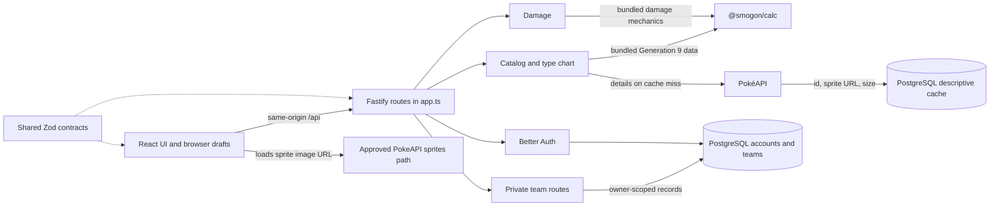

# How the website works

**Reviewed:** 2026-10-04. This guide describes the current local Generation 9 implementation after the code audit and localization refactor; it is a map of the code, not proof that every feature has passed a production acceptance test. The related [code audit](code-audit-2026-10-03.md) explains the earlier audit fixes and what was tested.

## The parts of the website

The website runs as one React application in the browser and one Fastify API process on the server. Its views are tabs on the single `/` URL: choosing a tab changes React state. A reload returns to Overview, and the current tab is not represented in browser history.

| Part | Where it lives | What it does |
| --- | --- | --- |
| Browser application and mount | [`apps/web/src/main.tsx`](../apps/web/src/main.tsx) | Mounts React StrictMode, owns tab navigation, shared catalog and library state, session coordination, both browser drafts, and the team-builder composition. It starts the catalog, chart, and session requests when the app mounts. |
| Feature views | [`apps/web/src/features/`](../apps/web/src/features/) | Keeps Overview, Type chart, Pokédex, Team editor, team comparison, Damage, and Account components in their feature folders. Their private state and effects live alongside the components. |
| Browser API client and localized errors | [`apps/web/src/lib/api.ts`](../apps/web/src/lib/api.ts) and [`apps/web/src/lib/errors.ts`](../apps/web/src/lib/errors.ts) | Adds `/api` to a request, sends same-origin cookies, checks typed responses with shared Zod schemas, and formats failures from stable API codes and validation details through locale resources. Network and unexpected-response messages also come from those resources. |
| Locale strings | [`apps/web/src/locales/en.ts`](../apps/web/src/locales/en.ts), [`apps/web/src/i18n.ts`](../apps/web/src/i18n.ts), and [`apps/web/src/i18n/presentation.ts`](../apps/web/src/i18n/presentation.ts) | Holds the typed English UI catalog, locale registry, page-load locale snapshot, shared display helpers, message formatting, and optional domain-label dictionaries. English is currently the only registered locale; there is no language selector. |
| Translated catalog labels and input | [`apps/web/src/lib/catalog-labels.ts`](../apps/web/src/lib/catalog-labels.ts) and [`apps/web/src/components/catalog-input.tsx`](../apps/web/src/components/catalog-input.tsx) | Translates displayed species, moves, items, abilities, natures, and types while retaining canonical English values. Recognized input resolves to a canonical catalog name; incomplete edits remain unchanged. Shared datalists avoid copying the full catalog into each team field. |
| Browser draft storage | [`apps/web/src/lib/team-drafts.ts`](../apps/web/src/lib/team-drafts.ts) | Reads and writes both drafts under versioned local-storage keys, imports the older keys when present, tolerates unavailable storage, and preserves incomplete edits. |
| Shared rules and response shapes | [`packages/contracts/src/index.ts`](../packages/contracts/src/index.ts) | Defines what a Pokémon set, submitted team, damage request, API response, and in-progress browser draft look like. Submission validation remains stricter than draft recovery. |
| API composition and routes | [`apps/api/src/app.ts`](../apps/api/src/app.ts) | Composes Fastify plugins and registers public data, Pokédex, damage, team, account, health, and development routes. [`apps/api/src/main.ts`](../apps/api/src/main.ts) starts the server process. |
| Database setup | [`apps/api/src/db.ts`](../apps/api/src/db.ts) and [`apps/api/prisma/schema.prisma`](../apps/api/prisma/schema.prisma) | Connect Prisma to PostgreSQL. Account records and saved teams live there; `PokedexCache` stores selected descriptive PokéAPI fields. |
| Local website delivery | [`apps/web/vite.config.ts`](../apps/web/vite.config.ts), [`apps/web/src/style.css`](../apps/web/src/style.css), [`apps/web/index.html`](../apps/web/index.html), [`apps/api/src/main.ts`](../apps/api/src/main.ts) | Vite serves the browser app during development and proxies `/api` to Fastify. For a built deployment, Fastify serves the built website and API from the same image. |

The browser-to-server flow is:

## Translation resources and canonical values

Interface wording, placeholders, notices, accessibility text, validation messages, and error labels live in `locales/en.ts`. Its `LocaleMessages` type requires the same message keys in another locale while permitting different string values. `i18n.ts` registers `LocaleResources`, containing `messages` and a `catalog` dictionary; `getMessages()`, `getCatalogTranslations()`, and `formatMessage()` read those resources and substitute named placeholders. The application resolves the browser language at page load and applies that locale to the document language and title. It tries an exact registered locale, then its base language, then English. Only English is registered, with an empty domain-label dictionary, so all browser languages currently render English.

Battle data still uses the canonical English names returned by `/api/catalog`. Optional dictionaries translate their display labels by category: `species`, `moves`, `items`, `abilities`, `natures`, and `types`. Keys use `catalogId()`, which lowercases a canonical name and removes every character except ASCII letters and digits; for example, `Thunderbolt` uses `thunderbolt`. Missing or blank entries display the original catalog name. These dictionaries change labels, not Smogon data, draft identifiers, database records, or API request values.

`CatalogInput` displays a translated suggestion but writes its canonical name when a recognized suggestion is selected or entered. Canonical English names also remain valid input. If translated suggestions collide with one another or another canonical name, `catalogOptions()` adds the canonical name in parentheses, such as `Shared (Thunderbolt)` and `Shared (Protect)`, so each choice resolves unambiguously. Unrecognized or incomplete text is retained exactly while editing; normal save/calculation validation still rejects invalid submitted names. Nature and Tera-type selects likewise display translated labels while retaining canonical option values. Pokédex search accepts both displayed and English names, and sends the selected canonical species to its endpoint.

The server's [error resources](../apps/api/src/resources/errors.ts) retain English compatibility text. App-owned failures also carry stable codes and optional field/rule details from the shared contracts. `lib/errors.ts` converts those fields, local Zod validation failures, and recognized Better Auth codes into locale messages; it does not display arbitrary server or authentication prose. The API does not negotiate or return translated catalog names.

Damage responses provide a structured `matchup` and `hasEffect`, letting the result summary use locale templates and domain labels. The existing English `description` remains a compatibility field for detailed Smogon calculator prose. The UI shows it inside “Calculation details” only when the resolved locale is `en`; other future locales can show the structured summary and numeric results without untranslated calculator prose. User-entered team names and nicknames remain content rather than interface translations.

## What each view shows and where its data comes from

| View | What the user sees | Request and server logic | Source and storage |
| --- | --- | --- | --- |
| Overview | Introductory text and shortcuts into the team builder, calculator, and type chart. | [`features/overview/Overview.tsx`](../apps/web/src/features/overview/Overview.tsx); no Overview-specific route. Startup loads the catalog, chart, and session in `main.tsx`. | Interface copy comes from `locales/en.ts`; no sample team or seed database is used. |
| Type chart | Choose one or two defending types with buttons, or use the Pokémon finder to fill them in. The matching attacking types appear in multiplier groups; a selected Pokémon's sprite is shown when available. | UI and derived matchup groups: [`features/type-chart/TypeChart.tsx`](../apps/web/src/features/type-chart/TypeChart.tsx). `GET /api/type-chart` and `GET /api/catalog` supply the Gen 9 effectiveness chart and canonical species typings. A recognized Pokémon also uses the existing `GET /api/pokedex/:species` sprite lookup. | Matchups come from the bundled, pinned Generation 9 `@smogon/calc` data. Species types come from the same battle catalog. The optional sprite uses the existing PokéAPI cache and sprite host; the matchup calculation remains available if descriptive data or its image is unavailable. |
| Pokédex | Search the known species/form list, view types in search results and six battle-stat meters, then show an available Pokédex number and sprite. | Screen coordination and cancellable detail request: [`features/pokedex/Pokedex.tsx`](../apps/web/src/features/pokedex/Pokedex.tsx), with colocated `PokemonList` and `PokemonDetail` sections. `GET /api/catalog` supplies the search list and battle stats. Selecting a name requests `GET /api/pokedex/:species`. [`modules/catalog/pokeapi-adapter.ts`](../apps/api/src/modules/catalog/pokeapi-adapter.ts) checks the name, reads the optional cache, and fetches PokéAPI when needed. | Battle stats still come from `@smogon/calc`. Only descriptive data comes from PokéAPI and the PostgreSQL `PokedexCache`. The server returns a **sprite URL**; the browser separately asks the approved sprite host for the image. The UI currently shows the ID and sprite, not returned height or weight. A missing/stale descriptive response does not replace battle stats. Search displays at most 60 matches. |
| Team builder | Two drafts of up to six Pokémon. Each set has a species, nickname, item, ability, nature, level, Tera type, status, four move slots, EVs, IVs, and boosts. | Team and draft coordination: [`features/teams/TeamEditor.tsx`](../apps/web/src/features/teams/TeamEditor.tsx). Individual Pokémon controls: [`features/teams/PokemonSetEditor.tsx`](../apps/web/src/features/teams/PokemonSetEditor.tsx). Editing and comparison are local browser state. Shared contracts validate and normalize data when submitting a save. `GET /api/me/teams`, `POST /api/me/teams`, and `DELETE /api/me/teams/:id` list, create, and remove the signed-in user's private records. | The two drafts persist in this browser's local storage. A versioned migration imports `pokemon-guest-team` and `pokemon-comparison-team`. Reused set defaults and submission normalization live in [`features/teams/team-model.ts`](../apps/web/src/features/teams/team-model.ts). Saved records use PostgreSQL through [`modules/teams/teams.ts`](../apps/api/src/modules/teams/teams.ts) and [`modules/teams/prisma-adapter.ts`](../apps/api/src/modules/teams/prisma-adapter.ts). Saving sends Team A; there is no save control for the comparison draft. |
| Team comparison | Team names, member counts, and the distinct Pokémon types present in each draft. | UI and browser-side calculation: [`features/teams/Compare.tsx`](../apps/web/src/features/teams/Compare.tsx). It prepares a short summary for each draft using the current drafts and bundled catalog; no separate API route. | It summarizes member types only. It does not calculate defensive weaknesses, move coverage, or a predicted battle outcome. |
| Damage | Attacker, defender, move, Singles/Doubles, weather, terrain, screens, field effects, and an HP/percentage damage range plus one-hit KO chance. A structured matchup/no-effect summary uses locale messages; detailed calculator prose is available under “Calculation details” in English. | Request state, validation, and stale-response guard: [`features/damage/Damage.tsx`](../apps/web/src/features/damage/Damage.tsx). Form controls: [`features/damage/DamageForm.tsx`](../apps/web/src/features/damage/DamageForm.tsx). Estimate display: [`features/damage/DamageResult.tsx`](../apps/web/src/features/damage/DamageResult.tsx). `POST /api/damage`; shared input validation leads to [`modules/damage/smogon-adapter.ts`](../apps/api/src/modules/damage/smogon-adapter.ts), which builds Generation 9 calculator inputs and calls `@smogon/calc`. | Pinned calculator data and mechanics; no database or remote battle-data request. The KO chance is conditional on the move hitting; accuracy is excluded. Editing a set hides its old result until recalculated. Calculator-only edits/results are reset when leaving the tab. |
| Account | Email/password registration and sign-in, the signed-in user, and a sign-out button. The team builder shows the user's private saved-team library. | Screen state and authentication coordination: [`features/account/Account.tsx`](../apps/web/src/features/account/Account.tsx), with colocated `AuthenticationForm` and `SignedInAccount` sections. Better Auth receives `GET/POST /api/auth/*`. The app also calls `/api/auth/get-session`; team routes require a valid session and filter by its owner. The team builder's library controls are colocated with app composition in `main.tsx`. | Better Auth and Prisma store users, sessions, accounts, and verifications in PostgreSQL. SMTP is optional in configuration; with SMTP enabled, email verification/reset delivery is configured, but the current UI does not expose those workflows. |

## What the website does not do

- It does not implement separate page URLs, back/forward tab navigation, older game generations, Spanish UI, or a battle simulator.
- Locale resources and optional domain-label dictionaries are ready for future translations, but no additional production locale or language-selector UI has been added. The selected locale is currently resolved at page load; a future selector will need to update the active resources and rendered interface.
- Known Pokémon, moves, items, and abilities are checked against the catalog; that does not prove a tournament set is legal or historically used.
- The team-size cap is six, but an incomplete team can still be drafted and the current schema permits saving an empty team. This audit does not set a new team-size policy.
- A saved team opened from the library becomes the Team A browser draft. That draft continues to persist on the device after logout, because it shares the intended guest-draft storage. Logout immediately hides and discards in-memory private-library rows, but does not erase the browser draft.
- Pro-team sets are selected and transcribed from their linked publications. They are not complete exports of every possible simulator field.
- Pokédex sprite bytes remain external and depend on that image host. Height and weight are returned by the server but not shown in the present view.
- Better Auth handles its own wildcard account endpoints. Those operations do not have the same hand-written operation-by-operation OpenAPI descriptions as the project-owned feature routes.

## Where to change something

| If you want to change… | Start here |
| --- | --- |
| View layout, tab navigation, session coordination, or private-team library interactions | [`apps/web/src/main.tsx`](../apps/web/src/main.tsx); feature UI lives under [`apps/web/src/features/`](../apps/web/src/features/) |
| Colors, spacing, responsive layout | [`apps/web/src/style.css`](../apps/web/src/style.css) |
| Request URLs, browser cookies, or response checks | [`apps/web/src/lib/api.ts`](../apps/web/src/lib/api.ts) |
| UI wording or an additional language | [`apps/web/src/locales/en.ts`](../apps/web/src/locales/en.ts), then add a typed locale file and register it in [`apps/web/src/i18n.ts`](../apps/web/src/i18n.ts); shared display helpers are in [`apps/web/src/i18n/presentation.ts`](../apps/web/src/i18n/presentation.ts) |
| Translated Pokémon/move/item/ability/nature/type labels and input resolution | [`apps/web/src/lib/catalog-labels.ts`](../apps/web/src/lib/catalog-labels.ts), [`apps/web/src/components/catalog-input.tsx`](../apps/web/src/components/catalog-input.tsx), shared suggestions in [`apps/web/src/components/catalog-datalists.tsx`](../apps/web/src/components/catalog-datalists.tsx), and the `catalog` resource registered in [`apps/web/src/i18n.ts`](../apps/web/src/i18n.ts) |
| Localized client errors or validation wording | [`apps/web/src/lib/errors.ts`](../apps/web/src/lib/errors.ts) and [`apps/web/src/locales/en.ts`](../apps/web/src/locales/en.ts); server compatibility messages are in [`apps/api/src/resources/errors.ts`](../apps/api/src/resources/errors.ts) |
| Guest draft migration and browser persistence | [`apps/web/src/lib/team-drafts.ts`](../apps/web/src/lib/team-drafts.ts) and [`packages/contracts/src/index.ts`](../packages/contracts/src/index.ts) |
| Species list, stats, type chart, or catalog name checks | [`apps/api/src/modules/catalog/catalog.ts`](../apps/api/src/modules/catalog/catalog.ts) |
| Pokédex lookup/cache/form mapping/sprite policy | [`apps/api/src/modules/catalog/pokeapi-adapter.ts`](../apps/api/src/modules/catalog/pokeapi-adapter.ts) |
| Damage inputs or result calculation | [`apps/api/src/modules/damage/damage.ts`](../apps/api/src/modules/damage/damage.ts) and [`apps/api/src/modules/damage/smogon-adapter.ts`](../apps/api/src/modules/damage/smogon-adapter.ts) |
| Saved-team ownership or Prisma queries | [`apps/api/src/modules/teams/teams.ts`](../apps/api/src/modules/teams/teams.ts), [`apps/api/src/modules/teams/prisma-adapter.ts`](../apps/api/src/modules/teams/prisma-adapter.ts), and [`apps/api/src/app.ts`](../apps/api/src/app.ts) |
| Login, account cookies, or email delivery | [`apps/api/src/modules/auth/auth.ts`](../apps/api/src/modules/auth/auth.ts) |
| Routes, API errors, Origin checks, or OpenAPI | [`apps/api/src/app.ts`](../apps/api/src/app.ts), [`apps/api/src/origins.ts`](../apps/api/src/origins.ts), and [`packages/contracts/src/index.ts`](../packages/contracts/src/index.ts) |
| PostgreSQL tables or migrations | [`apps/api/prisma/schema.prisma`](../apps/api/prisma/schema.prisma) and [`apps/api/prisma/migrations/`](../apps/api/prisma/migrations/) |

The [architecture map](architecture/architecture.md), [API contract guide](api-contracts.md), [data source policy](data-sources.md), [requirements](requirements/requirements.md), and [test strategy](testing/test-strategy.md) give the broader design, data rules, requirements, and verification status.
